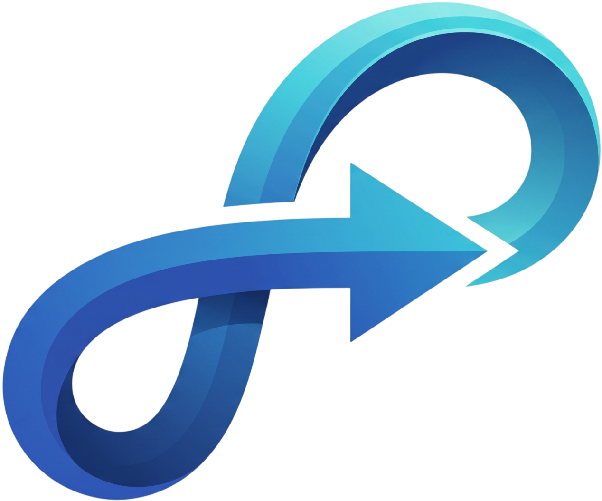

# FerryClip

<p align="center"></p>

<p align="center"><strong>Clipboard sync between Windows and Android over your local network.</strong></p>

<p align="center">
  
  
  
  <a href="LICENSE"></a>
</p>

FerryClip supports Android 7.0 (API 24) and newer; Android 10 or newer is required for TLS 1.3 sync. It connects a Windows PC and Android phone on the same reachable Wi-Fi, hotspot, Ethernet, or VPN-routed local network. Clipboard data transfers directly between paired devices; there is no account, cloud relay, or internet requirement for syncing.

## Features

- Pair with a short-lived six-digit code generated on Windows.
- Save and manage multiple PCs independently; connect, pause, resume, rename, or forget each device.
- Recover connections over local Wi-Fi and hotspot networks, with manual IP entry when discovery cannot reach the PC.
- Protect device identities with pinned certificates and mutually authenticated TLS 1.3.
- Sync plain text only: Windows-to-Android delivery is automatic while connected; sending Android-to-Windows requires tapping the notification action or Quick Settings tile. Image and file transfer are not supported.
- Keep optional clipboard history locally, encrypted at rest, with controls for retention, item limits, sensitive clips, app lock, and deletion. History is not shared across devices or uploaded.
- Use the Windows system-tray popover or the full Windows main window to manage pairing, devices, history, settings, and help.

Android requires a deliberate user action to send phone clipboard contents. The app does not silently send clipboard changes from Android.

## Downloads

- [FerryClip website](https://www.ferryclip.app)
- [GitHub Releases](https://github.com/Tanishktewetia/FerryClip/releases)

Release availability and signing status are shown on the release page. The current build scripts produce a debug-signed Android release APK and an unsigned Windows executable; these are testing builds, not production-signed releases.

## Build from source

Requirements from the project configuration: **.NET 10 SDK**, **JDK 17**, **Android SDK Platform 34**, and PowerShell on Windows. Gradle Wrapper 8.11.1 and Android Gradle Plugin 8.7.3 are configured in the repository. Node.js is only needed for the static website.

```powershell
# Build the Windows exe, portable ZIP, and Inno Setup installer
.\scripts\build-windows-installer.ps1

# Build the Android release APK (requires the local release signing key)
.\scripts\build-android.ps1

# Optional: build and preview the static website
node site/build.cjs
node site/serve.cjs
```

Build artifacts are placed in `dist/`. The Windows executable is self-contained; the Inno Setup installer and portable ZIP bundle it. Android release APKs are built and signed locally; CI assembles debug APKs only.

## Privacy and troubleshooting

Clipboard sync is local-network-only and protected with TLS 1.3. Android history uses a key protected by Android Keystore; Windows history is protected with current-user Windows Data Protection. History is local to each device. Pausing sync stops transfer in both directions. Android background recovery can depend on notification and battery settings.

For diagnostics, use **Advanced → Diagnostics** on Android or **Open Log Folder** from the Windows tray menu. When reporting an issue, include app versions, network mode, test steps, and expected versus actual behavior. Do not include clipboard contents or other private data.

## Contributing and issues

Bug reports, questions, and contributions are welcome. Please [open an issue](https://github.com/Tanishktewetia/FerryClip/issues) with reproduction steps and relevant diagnostic details.

## License

[](LICENSE)

FerryClip is licensed under the [MIT License](LICENSE). Third-party components and their license texts are listed in [THIRD_PARTY_NOTICES.md](THIRD_PARTY_NOTICES.md).

The FerryClip name and logo are not licensed for use in modified or unofficial versions.
